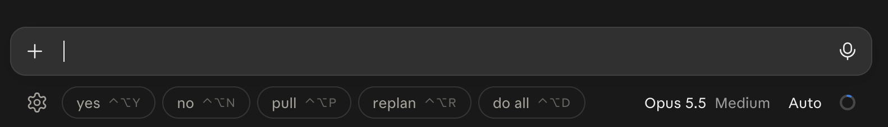

# Claude Code Web Shortcuts

A Chrome/Firefox extension that adds one-click quick replies to Claude Code on the web (`claude.ai/code`).

The buttons sit under the message box, on the same line as the model picker:

Clicking a button, or pressing its keychord, replaces whatever is in the message box with that button's message and sends it immediately. The buttons pick up the page's font and colors, so they match light and dark mode.

## Defaults

| Button | Sends | Shortcut |
|---|---|---|
| yes | Yes, continue | Ctrl+Alt+Y |
| no | No, stop | Ctrl+Alt+N |
| pull | Pull and rebase everything on main | Ctrl+Alt+P |
| replan | Replan | Ctrl+Alt+R |
| do all | Do everything you just suggested | Ctrl+Alt+D |

On macOS, Ctrl+Alt is ⌃⌥. Shortcuts match the physical key, so ⌥+letter works even though macOS would normally type a special character.

## Install

**Chrome:** open `chrome://extensions`, turn on Developer mode, click "Load unpacked" and choose this folder.

**Firefox:** open `about:debugging#/runtime/this-firefox`, click "Load Temporary Add-on…" and choose `manifest.json`. Temporary add-ons are removed when Firefox restarts. To keep it installed, sign it through addons.mozilla.org (unlisted is fine). `./package.sh` builds the zip to upload.

## Settings

Open settings with the ⚙ at the start of the button row, or the extension's toolbar icon. You can:

- **Buttons:** add, remove, reorder and edit buttons (label, message, shortcut).
- **Shortcuts:** click a shortcut to record a new one. Two steps make a chord: `Ctrl+K Y` means press Ctrl+K, then Y within 1.5s. Esc cancels; Backspace clears. A shortcut used by two buttons is outlined in red.
- **Send immediately:** turn this off and buttons only fill in the message box.
- **Position:** "Below, beside the model picker" (default) or "Above the message box".
- **Active on paths starting with:** defaults to `/code`.
- **Advanced:** CSS selector overrides for the message box, the send button, the row below the box, and the element to sit above. Use these if a claude.ai redesign breaks auto-detection.

Changes save automatically to `storage.sync`, so they follow your browser profile.

## How it works

- **Message box:** the focused editable element, or otherwise the bottom-most visible `textarea` / `contenteditable`.
- **Input box card:** the nearest ancestor of the message box with a border, shadow or rounded fill.
- **Row below the box:** probed geometrically. It checks just under the card's right side, where the model picker is, then walks up to the first element that spans most of the card's width without containing it. The bar is inserted as that row's first child with `margin-right: auto`, which pushes the page's own controls to the right. If no row is found, the bar goes above the card.
- **Inserting text:** a textarea gets its value set through the native setter plus an `input` event. A contenteditable (ProseMirror and similar) gets select-all plus `execCommand('insertText')`, so the editor's own state updates.
- **Sending:** it clicks the nearest enabled send/submit button, and falls back to an Enter keypress.
- **Styling:** the bar lives in a shadow root, so page CSS doesn't leak in. It borrows the message box's font, text color, border color and background at runtime. Light or dark is decided from the page's actual background, not the OS setting.
- **Staying attached:** a MutationObserver re-places the bar as the single-page app re-renders.

## Debugging

In DevTools → Console, with the Verbose level on, the extension logs `[claude-code-web-shortcuts] row below input: <element>` whenever the target row changes. `null` means it fell back to placing the bar above the box.

## Files

| File | Purpose |
|---|---|
| `manifest.json` | MV3 manifest for both Chrome and Firefox |
| `defaults.js` | Default buttons/settings and shortcut parsing (shared) |
| `content.js` | Bar UI, placement, text insertion, keychords |
| `options.html`, `options.js` | Settings page |
| `background.js` | Opens the settings page from the toolbar icon or ⚙ |
| `package.sh` | Builds `dist/claude-code-web-shortcuts-<version>.zip` |
